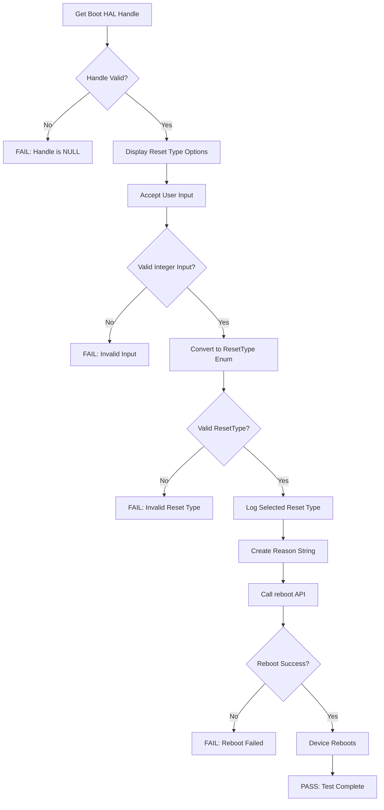
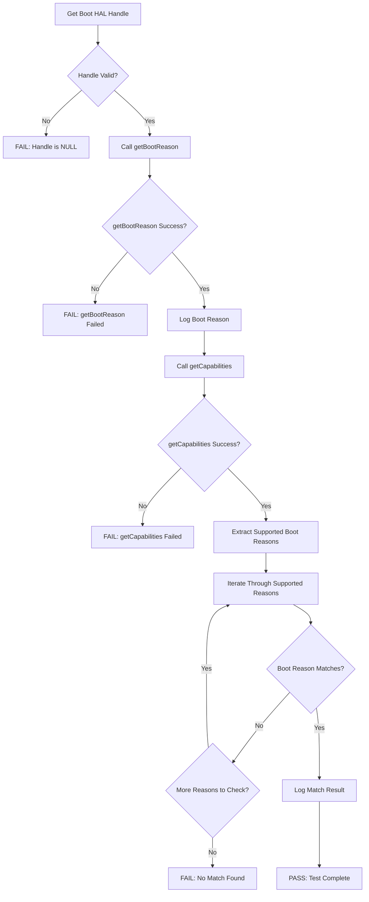
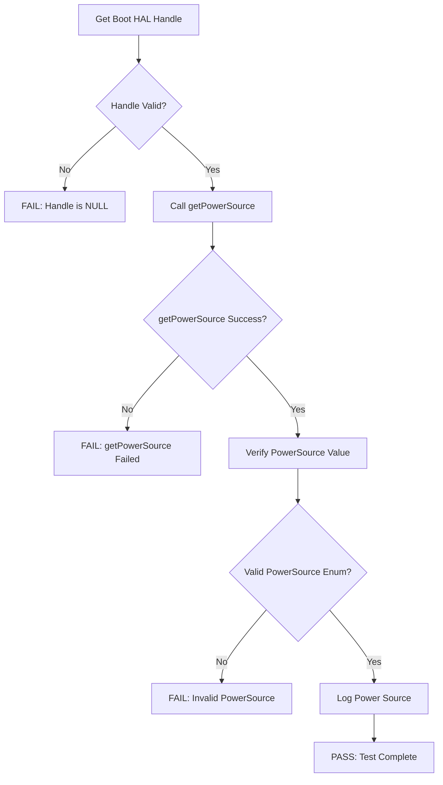
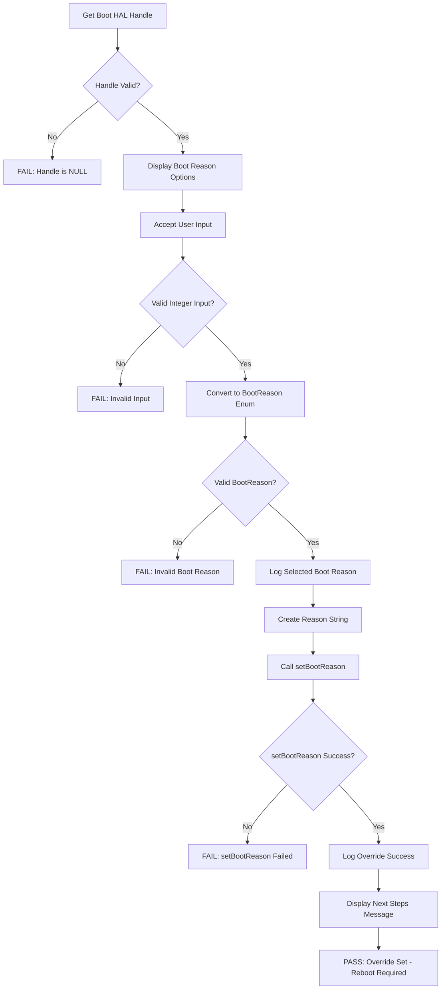

# Boot HAL L3 Low Level Test Specification and Procedure Documentation

## Table of Contents

- [Acronyms, Terms and Abbreviations](#acronyms-terms-and-abbreviations)
- [Scope](#scope)
- [Level 3 Test Procedure](#level-3-test-procedure)
- [Level 3 Test Cases Overview](#level-3-test-cases-overview)
- [References](#references)

## Acronyms, Terms and Abbreviations

- `HAL`  - Hardware Abstraction Layer
- `AIDL` - Android Interface Definition Language
- `API`  - Application Programming Interface
- `L3`   - Level 3 Testing
- `VTS`  - Vendor Test Suite
- `BOOT` - Boot subsystem
- `OEM`  - Original Equipment Manufacturer
- `SOC`  - System on Chip
- `RDK`  - Reference Design Kit
- `UT`   - Unit Test

## Scope

This document describes the L3 Low Level Test Specification and Procedure Documentation for the Boot HAL (Hardware Abstraction Layer). It provides detailed test specifications for validating the Boot HAL's functionality in real-world scenarios.

### Level 3 Testing Scope

Level 3 testing focuses on end-to-end functional validation of Boot HAL APIs with actual hardware operations. The L3 test suite verifies:

- **Reboot Operations**: Testing device reboot functionality with various reset types
- **Boot Reason Verification**: Validating boot reasons after device reboots
- **Power Source Detection**: Verifying the device's power source information
- **Boot Reason Override**: Testing the ability to override boot reasons before reboot
- **State Persistence**: Ensuring boot-related state persists across reboots
- **Real Hardware Integration**: Testing with actual device hardware and firmware

The L3 tests require user interaction and device reboots, validating that the Boot HAL implementation correctly interacts with the underlying hardware and firmware components.

## Level 3 Test Procedure

The L3 test suite validates the Boot HAL's functionality through real device operations:

1. Establishing a connection to the Boot HAL service via AIDL
2. Accepting user input for test parameters (reset types, boot reasons)
3. Executing device reboot operations using `reboot()` API
4. Verifying boot reasons using `getBootReason()` after reboot
5. Checking device power source using `getPowerSource()` API
6. Testing boot reason override functionality with `setBootReason()`
7. Validating actual device behavior matches expected outcomes
8. Verifying state persistence across reboots

### Test Setup

#### Hardware/Software Requirements

| Required | Description |
|----------|-------------|
| Device Under Test | Target device with Boot HAL implementation |
| Test Framework | UT-Core Framework v4.7.0 or later |
| AIDL Support | Linux Binder with AIDL support |
| Boot HAL | Vendor implementation of com.rdk.hal.boot.IBoot |
| Network Access | Required for verifying device availability after reboot |
| Console Access | Required for monitoring reboot process |
| Profile Configuration | YAML profile defining supported boot capabilities |

## Level 3 Test Cases Overview

The following C++ test cases validate the Boot HAL L3 functionality:

### Test Suite: VTS_L3_BOOT

| Test Case | Description | HAL APIs | L3 Test Functions | Source |
|-----------|-------------|----------|-------------------|---------|
| rebootSystem | Validates device reboot with user-selected reset type | `IBoot::reboot()` | `test_l3_boot_rebootSystem()` | [vts_boot_l3_tests.cpp](../../src/vts_boot_l3_tests.cpp) |
| checkBootReason | Validates boot reason retrieval and verification against supported capabilities | `IBoot::getBootReason()` `IBoot::getCapabilities()` | `test_l3_boot_checkBootReason()` | [vts_boot_l3_tests.cpp](../../src/vts_boot_l3_tests.cpp) |
| checkPowerSource | Validates power source detection | `IBoot::getPowerSource()` | `test_l3_boot_checkPowerSource()` | [vts_boot_l3_tests.cpp](../../src/vts_boot_l3_tests.cpp) |
| overrideBootReason | Validates boot reason override functionality before reboot | `IBoot::setBootReason()` `IBoot::getBootReason()` | `test_l3_boot_overrideBootReason()` | [vts_boot_l3_tests.cpp](../../src/vts_boot_l3_tests.cpp) |

---

## Test Case Details

### Test 1: rebootSystem

| Title | Details |
|-------|----------|
| Function Name | `rebootSystem` |
| Description | This test validates the device reboot functionality with user-selected reset type. It ensures that the `reboot()` API successfully initiates a device reboot with the specified reset type and reason string. |
| Test Group | 03 |
| Test Case ID | 001 |
| Priority | High |

**Pre-Conditions:** 
- Boot HAL service must be running and accessible
- Device must support reboot operations
- User must have console/network access to device
- Device must be in operational state

**Dependencies:** 
- Boot HAL Interface: `com.rdk.hal.boot.IBoot`
- UT-Core Framework
- Profile configuration with supported reset types
- Network connectivity for post-reboot verification

**User Interaction:** 
Yes - User must select a reset type from the available options presented in the console.

**Test Flow Diagram:**

**Test Procedure:**

| Variation / Steps | Description | Test Data | Expected Result | Notes |
|-------------------|-------------|-----------|-----------------|-------|
| 1 | Get Boot HAL Handle | None | Boot HAL handle should be non-null (`bootHandle != nullptr`) | Verify service is accessible |
| 2 | Display Reset Type Options | None | Display all ResetType enum values to user | Includes: FULL_SYSTEM_RESET, INVALIDATE_CURRENT_APPLICATION_IMAGE, FORCE_DISASTER_RECOVERY, MAINTENANCE_REBOOT, SOFTWARE_REBOOT |
| 3 | Accept User Input | User selects reset type by entering integer | Valid integer input received | User chooses reset type index |
| 4 | Validate Input | Check if input is valid integer | Input validation succeeds | Handle invalid input gracefully |
| 5 | Convert to ResetType Enum | Cast integer to ResetType | Valid ResetType enum value obtained | |
| 6 | Verify Reset Type is Supported | Check against enum values | Selected reset type matches a valid enum value | Log selected reset type |
| 7 | Create Reason String | Convert enum to string | Reason string created from reset type | e.g., "MAINTENANCE_REBOOT" |
| 8 | Call reboot() API | `resetType` + `reasonString` | `reboot()` returns success `Status::isOk() == true` `exceptionCode == EX_NONE` | Device begins reboot process |
| 9 | Device Reboots | None | Device successfully reboots | Test ends, device restarts |

---

### Test 2: checkBootReason

| Title | Details |
|-------|----------|
| Function Name | `checkBootReason` |
| Description | This test validates that the boot reason retrieved from the device matches one of the supported boot reasons defined in the device capabilities. It verifies proper boot reason tracking across device boots. |
| Test Group | 03 |
| Test Case ID | 002 |
| Priority | High |

**Pre-Conditions:** 
- Boot HAL service must be running and accessible
- Device must have booted successfully
- Device must have a valid boot reason set

**Dependencies:** 
- Boot HAL Interface: `com.rdk.hal.boot.IBoot`
- UT-Core Framework
- Profile configuration with supported boot reasons

**User Interaction:** 
If user chose to run the test in interactive mode, then the test case has to be selected via console.

**Test Flow Diagram:**

**Test Procedure:**

| Variation / Steps | Description | Test Data | Expected Result | Notes |
|-------------------|-------------|-----------|-----------------|-------|
| 1 | Get Boot HAL Handle | None | Boot HAL handle should be non-null (`bootHandle != nullptr`) | Verify service is accessible |
| 2 | Get Current Boot Reason | None | `getBootReason()` returns success Valid BootReason enum value returned | Retrieve current boot reason |
| 3 | Log Boot Reason | Boot reason value | Boot reason logged successfully | Display boot reason string |
| 4 | Get Device Capabilities | None | `getCapabilities()` returns success Capabilities structure populated | Retrieve supported boot reasons |
| 5 | Extract Supported Boot Reasons | Capabilities structure | List of supported boot reasons obtained | From `capabilities.supportedBootReasons` |
| 6 | Iterate Through Supported Reasons | Compare each supported reason | Loop through all supported boot reasons | |
| 7 | Match Boot Reason | Current boot reason vs supported | Find matching boot reason in supported list | |
| 8 | Validate Match Found | Boolean check | `reasonMatched == true` | Boot reason must be in supported list |
| 9 | Log Match Result | Matched boot reason | Log successful match | Display matched boot reason |
| 10 | Test Complete | None | Boot reason validated successfully | Test PASS |

---

### Test 3: checkPowerSource

| Title | Details |
|-------|----------|
| Function Name | `checkPowerSource` |
| Description | This test validates the device's power source detection functionality. It retrieves the current power source and verifies the API returns successfully. |
| Test Group | 03 |
| Test Case ID | 003 |
| Priority | Medium |

**Pre-Conditions:** 
- Boot HAL service must be running and accessible
- Device must be powered on
- Power source detection hardware must be functional

**Dependencies:** 
- Boot HAL Interface: `com.rdk.hal.boot.IBoot`
- UT-Core Framework
- Power source detection hardware/firmware

**User Interaction:** 
If user chose to run the test in interactive mode, then the test case has to be selected via console.

**Test Flow Diagram:**

**Test Procedure:**

| Variation / Steps | Description | Test Data | Expected Result | Notes |
|-------------------|-------------|-----------|-----------------|-------|
| 1 | Get Boot HAL Handle | None | Boot HAL handle should be non-null (`bootHandle != nullptr`) | Verify service is accessible |
| 2 | Call getPowerSource() API | None | `getPowerSource()` returns success `Status::isOk() == true` `exceptionCode == EX_NONE` | Retrieve current power source |
| 3 | Verify PowerSource Value | PowerSource enum | Valid PowerSource enum value returned | One of: UNKNOWN, PSU, USB, POE |
| 4 | Log Power Source | Power source value | Power source logged successfully | Display power source string |
| 5 | Test Complete | None | Power source retrieved successfully | Test PASS |

---

### Test 4: overrideBootReason

| Title | Details |
|-------|----------|
| Function Name | `overrideBootReason` |
| Description | This test validates the boot reason override functionality. It allows the user to set a specific boot reason and prepares for verification after a subsequent reboot. This tests the `setBootReason()` API and prepares for cross-reboot validation. |
| Test Group | 03 |
| Test Case ID | 004 |
| Priority | High |

**Pre-Conditions:** 
- Boot HAL service must be running and accessible
- Device must support boot reason persistence
- Test requires write permissions for boot state

**Dependencies:** 
- Boot HAL Interface: `com.rdk.hal.boot.IBoot`
- UT-Core Framework
- Test 1 (rebootSystem) for subsequent verification
- Profile configuration with supported boot reasons

**User Interaction:** 
Yes - User must select a boot reason from the available options presented in the console, then manually execute Test 1 (rebootSystem) for verification.

**Test Flow Diagram:**

**Test Procedure:**

| Variation / Steps | Description | Test Data | Expected Result | Notes |
|-------------------|-------------|-----------|-----------------|-------|
| 1 | Get Boot HAL Handle | None | Boot HAL handle should be non-null (`bootHandle != nullptr`) | Verify service is accessible |
| 2 | Display Boot Reason Options | None | Display all BootReason enum values to user | Includes: ERROR_UNKNOWN, WATCHDOG, MAINTENANCE_REBOOT, THERMAL_RESET, WARM_RESET, COLD_BOOT, STR_AUTH_FAILURE |
| 3 | Accept User Input | User selects boot reason by entering integer | Valid integer input received | User chooses boot reason index |
| 4 | Validate Input | Check if input is valid integer | Input validation succeeds | Handle invalid input gracefully |
| 5 | Convert to BootReason Enum | Cast integer to BootReason | Valid BootReason enum value obtained | |
| 6 | Verify Boot Reason is Supported | Check against enum values | Selected boot reason matches a valid enum value | Log selected boot reason |
| 7 | Create Reason String | Convert enum to string | Reason string created from boot reason | e.g., "MAINTENANCE_REBOOT" |
| 8 | Call setBootReason() API | `bootReason` + `reasonString` | `setBootReason()` returns success `Status::isOk() == true` `exceptionCode == EX_NONE` | Boot reason override set |
| 9 | Log Override Success | Set boot reason | Log successful boot reason override | Display set boot reason |
| 10 | Display Next Steps | None | Instruct user to run Test 1 (rebootSystem) | User must manually verify with reboot |
| 11 | Test Complete | None | Boot reason override completed successfully | Test PASS - Requires subsequent reboot for full verification |

---

## References

- Boot HAL Interface Specification - [com.rdk.hal.boot.IBoot AIDL Interface](https://github.com/rdkcentral/rdk-halif-aidl/blob/main/boot/current/com/rdk/hal/boot/IBoot.aidl)
- Boot Reason Enumeration - [BootReason.aidl](https://github.com/rdkcentral/rdk-halif-aidl/blob/main/boot/current/com/rdk/hal/boot/BootReason.aidl)
- Reset Type Enumeration - [ResetType.aidl](https://github.com/rdkcentral/rdk-halif-aidl/blob/main/boot/current/com/rdk/hal/boot/ResetType.aidl)
- Power Source Enumeration - [PowerSource.aidl](https://github.com/rdkcentral/rdk-halif-aidl/blob/main/boot/current/com/rdk/hal/boot/PowerSource.aidl)
- Capabilities Structure - [Capabilities.aidl](https://github.com/rdkcentral/rdk-halif-aidl/blob/main/boot/current/com/rdk/hal/boot/Capabilities.aidl)
- High Level Test Specification - [Boot High Level Test Specification](https://github.com/rdkcentral/rdk-halif-aidl/blob/main/docs/pages/boot-high-level-test-spec.md)
