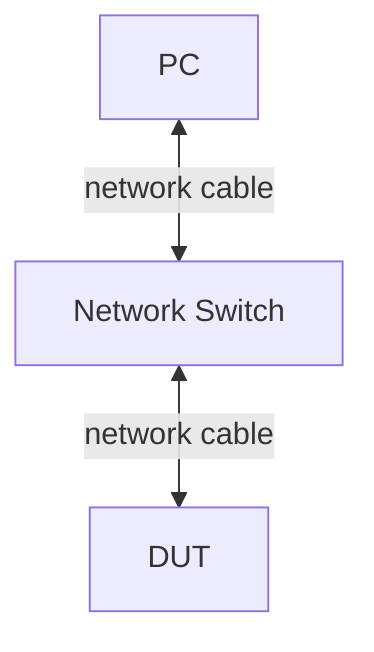
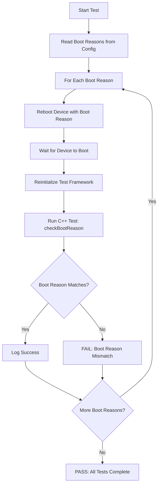
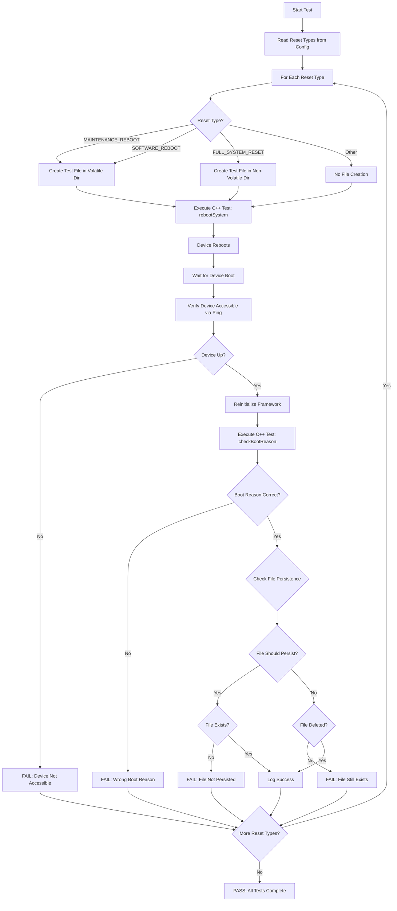
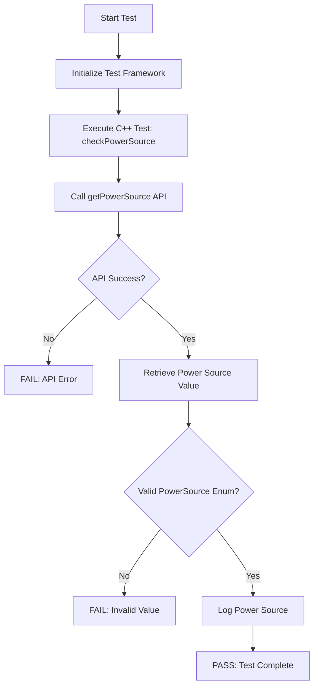
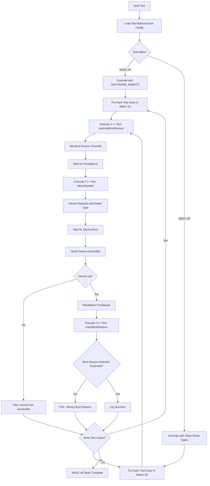

# Boot L1, L2, L3 Test Procedure

## Table of Contents
- [Acronyms, Terms and Abbreviations](#acronyms-terms-and-abbreviations)
- [Build the VTS](#build-the-vts)
- [Run L1 L2 Tests Without Python](#run-l1-l2-test-without-python)
- [Run Tests in Python Environment](#run-tests-in-python-environment)
  - [Update Configuration Files](#update-configuration-files)
  - [Install the Python Packages](#install-the-python-packages)
  - [Run the Tests](#run-test-cases)
- [Notes](#note)

## Acronyms, Terms and Abbreviations

- `HAL`    - Hardware Abstraction Layer
- `VTS`    - Vendor Test Suite
- `L1`     - Level 1 Testing
- `L2`     - Level 2 Testing
- `L3`     - Level 3 Testing
- `DUT`    - Device Under Test
- `RAFT`   - Rapid Automation Framework for Testing
- `YAML`   - YAML Ain't Markup Language
- `AIDL`   - Android Interface Definition Language

## Build the VTS

### Build Linux binder

The test suite depends on the Linux binder with `AIDL` support. Follow these steps to build it:

For detailed build instructions, please refer to [Linux Binder](https://github.com/rdkcentral/linux_binder_idl/tree/1.0.0)

Here are the simplest steps outlined:

```bash
git clone -b develop 'https://github.com/rdkcentral/linux_binder_idl.git'

cd linux_binder_idl

./build-linux-binder-aidl.sh 64
```

### Build VTS binaries

Clone and build the test suite:

```bash
git clone git@github.com:rdkcentral/rdk-halif-aidl-test-boot.git
```

```bash
cd rdk-halif-aidl-test-boot
```

Set the following environment variables:

- AIDL_BIN: Path to the `AIDL` compiler (e.g., /path/to/linux_binder_idl/out/aidl).

- LINUX_BINDER_OUT_DIR: Path to the Linux binder output directory (e.g., /path/to/linux_binder_idl/local).

- UT_CORE_VERSION: Specific version of the UT-Core framework (e.g., 4.7.0). Defaults to the latest tagged version.

- VCOMPONENT_BOOT_VERSION: Specific version of the Boot Virtual Component (e.g., 1.0.0). Defaults to the latest HEAD.

- RDK_HALIF_AIDL_VERSION: Specific version of the AIDL HAL Specification (e.g., 0.12.0). Defaults to the latest HEAD.

Example:

```bash
export UT_CORE_VERSION=5.0.0
export RDK_HALIF_AIDL_VERSION=0.13.1
export VCOMPONENT_BOOT_VERSION=0.1.0
export AIDL_BIN=/path/to/linux_binder_idl/out/aidl
export LINUX_BINDER_OUT_DIR=/path/to/linux_binder_idl/local/
```

By default, `UT` logs are disabled. To enable them, set the following environment variable:

```bash
export ENABLE_UT_INFO_LOGGING=1
```

Run the build script:

```bash
./build.sh Target=<Target-name>

# Supported Targets: linux, arm
```

The build.sh script:

- Clones the `rdk-halif-aidl` repository and UT-Core framework.
- Compiles the test suite.
- Generates binaries in the `build/bin` directory.
- Generates tar file `vts-boot.tar.gz` in the `build/bin` directory.

## Run L1 L2 Test Without Python

### Transfer Tar File to Target Device

Copy the `vts` binaries (`vts-boot.tar.gz`) to the target device (e.g., using `scp`):

```bash
scp -P <port> vts-boot.tar.gz root@target-device:/tmp/
```

### Extract on Target Device

Log into the target device and extract the tarball:

```bash
ssh root@target-device
mkdir /tmp/boot
tar -zxf vts-boot.tar.gz -C /tmp/boot
cd /tmp/boot
```

### Run the VTS Test on Target Device

Run the following command to execute the VTS test:

```bash
./run.sh -p profiles/hfp-boot-vcomponent.yaml
```

## Run Tests in Python Environment

### Update Configuration Files

#### Rack Configuration File

Example Rack configuration File: [vts_rack_configuration.yml](../../host/configs/vts_rack_configuration.yml)

For more details on rack configuration refer [RAFT](https://github.com/rdkcentral/python_raft/blob/1.8.0/README.md) and [example_rack_config.yml](https://github.com/rdkcentral/python_raft/blob/1.8.0/examples/configs/example_rack_config.yml)

In this file, update the configuration to define the console sessions for the `DUT` and the outbound settings:

|Console Session|Description|
|---------------|-----------|
|default|This session is used for basic operations, such as verifying the device status and retrieving the MAC address|
|ssh_hal_test|Executes the `HAL` binary for the test case|

```yaml
rackConfig:
    rack1:
        name: "rack1"
        description: "example config at my desk"
        slot1:
            # [ name: "required", description: "optional"]
            name: "slot1"
            devices:
                - dut:
                    ip: "127.0.0.1"  # IP Address of the ADA Hub
                    description: "PC"
                    platform: "vDevice"
                    consoles:
                        - default:
                            type: "ssh"
                            port: xx22
                            username: "root"
                            ip: "xx.0.0.1" #IP address
                            password: "root"
                            prompt: "~#" # Prompt string on console
                        - ssh_hal_test:
                            type: "ssh"
                            port: xx22
                            username: "root"
                            ip: "xx.0.0.1" #IP address
                            password: "root"
                            prompt: "~#" # Prompt string on console
                        - ssh_hal_test_1:
                            type: "ssh"
                            port: xx22
                            username: "root"
                            ip: "xx.0.0.1" #IP address
                            password: "root"
                            prompt: "~#" # Prompt string on console
                    outbound:
                        download_url: "tftp://tftp-server.com/rack1/slot1/"    # download location for the CPE device
                        upload_url: "sftp://server-address/home/workspace/tftp/rack1/slot1/" # upload location
                        upload_url_base_dir: "sftp://server-address/home/workspace/tftp/rack1/slot1" # alternative upload location
                        httpProxy:    # Local Proxy if required
                        workspaceDirectory: './logs/workspace'   # Local working directory
```

#### Device Configuration File

Example Device configuration File: [vts_device_configuration.yml](../../host/configs/vts_device_configuration.yml)

For more details refer [RAFT](https://github.com/rdkcentral/python_raft/blob/1.7.0/README.md) and [example_device_config.yml](https://github.com/rdkcentral/python_raft/blob/1.7.0/examples/configs/example_device_config.yml)

Ensure the `platform` should match with the `DUT` platform in [Rack Configuration](#rack-configuration-file)

```yaml
deviceConfig:
    cpe1:
        platform:   "ab" # User needs to update based on their soc
        model:      "xy" # User needs to update based on their soc
        soc_vendor: "xx" # User needs to update based on their soc
        target_directory: "/tmp/"
        boot_process_name: "Vendor-Boot"
        boot_non_volatile_directory: "/tmp/"  # User needs to update based on their soc
        boot_volatile_directory: "/home/root/" # User needs to update based on their soc
        prompt: "~#" # Prompt string on console
        wait_time: 40 # Configurable timeout value to limit the total duration of individual tests
        test:
            profile: "../../profiles/hfp-boot-vcomponent.yaml" #HFP profile used to meet platform requirements
            controller_port: 9081 #Port where the ut-controller is listening
```

### Install the Python Packages

[host](../../host/) folder contains the script files to install required packages and set up the Python environment.

- Run install.sh once to create the virtual environment
- source activate_venv.sh
- Run install.sh again to install dependencies inside the environment.

Run the following commands:

```bash
./install.sh
source activate_venv.sh
./install.sh
```

For more details refer [Python Set up](https://github.com/rdkcentral/ut-raft/wiki/Guide-for-Setting-up-the-Python-RAFT-Testing-Suite) and [Raft Setup](https://github.com/rdkcentral/python_raft/?tab=readme-ov-file#installation)

### Run Test Cases

#### L1 and L2

Once the environment is set up, execute the test cases with the following command:

```bash
python vts_boot_L1_L2_tests.py --config </PATH>/host/tests/configs/vts_rack_configuration.yml --deviceConfig </PATH>/host/tests/configs/vts_device_configuration.yml
```

#### L3

##### Device Setup

###### vDevice

For vDevice, no external hardware needs to be connected to the setup.

**UT-Controller Usage for vDevice:**

The Boot L3 tests use the UT-Controller to simulate boot scenarios on vDevice. The UT-Controller allows the test framework to trigger specific boot reasons and simulate real world reboots.

**How UT-Controller Works:**
- The test framework communicates with the vDevice via UT-Controller on a specified port (default: 9081)
- Boot reasons are sent as YAML-formatted messages to the controller
- The vDevice Boot HAL (Vendor-Boot process) receives these messages and simulates the boot behavior
- This enables automated testing of boot reason persistence and verification

**UT-Controller Message Format:**
```yaml
boot:
  command: bootReason
  params:
    reason: "<BOOT_REASON>"
```

**Supported Boot Reasons:**
- `WATCHDOG` - Watchdog timer expiration
- `MAINTENANCE_REBOOT` - Scheduled maintenance reboot
- `THERMAL_RESET` - Thermal event (overheating)
- `WARM_RESET` - Software-initiated warm reboot
- `COLD_BOOT` - Power-on from off state
- `STR_AUTH_FAILURE` - Suspend-to-RAM authentication failure
- `ERROR_UNKNOWN` - Unknown or undetermined boot reason

**Configuration:**
The UT-Controller port is specified in the device configuration file:
```yaml
test:
  controller_port: 9081  # Port where ut-controller is listening
```

**Process Flow for vDevice Testing:**
1. Test framework starts the Vendor-Boot process in background
2. Test sends boot reason via UT-Controller (using `sendMessage()`)
3. Vendor-Boot process receives and processes the boot reason
4. Device simulates reboot with specified boot reason
5. Test verifies the boot reason is correctly set and retrieved

**Note:** For real devices, the UT-Controller is not used. Instead, the test prompts the user to manually reboot the device with the appropriate boot trigger.

###### Real Device

The picture below depicts the Boot L3 Test Functionality Setup.



##### Run Tests

Once the environment is set up, execute the test cases with the following command:

```bash
python <testcase>.py --config </PATH>/host/tests/configs/vts_rack_configuration.yaml --deviceConfig </PATH>/host/tests/configs/vts_device_configuration.yaml
```

### L3 Test Cases

**Test Configuration File** [vts_l3_boot.yaml](../../test_configuration/vts_l3_boot.yaml)

#### Verify Boot Reason — `vts_boot_L3_VerifyBootReason.py`

**Path:** [vts_boot_L3_VerifyBootReason.py](../../host/tests/vts_boot_L3_VerifyBootReason.py)

**Purpose:** 
Validates that the device boot reason is correctly set and retrieved after a reboot. This test verifies that the boot reason persists across device reboots and matches the expected value.

**Test Flow:**



**Test Steps:**
- Read supported boot reasons from L3 configuration file
- For each boot reason:
  - Trigger device reboot with specified boot reason
  - Wait for device to reboot and become accessible
  - Reinitialize test framework after reboot
  - Execute C++ test case `checkBootReason` to verify boot reason
  - Validate that retrieved boot reason matches expected value
- Log results for each boot reason test
- Report overall test success/failure

---

#### Verify Reboot — `vts_boot_L3_VerifyReboot.py`

**Path:** [vts_boot_L3_VerifyReboot.py](../../host/tests/vts_boot_L3_VerifyReboot.py)

**Purpose:**
Validates device reboot functionality with different reset types. This test verifies that the device reboots correctly with various reset types and that boot reasons are set appropriately based on the reset type used.

**Test Flow:**



**Test Steps:**
- Read supported reset types from L3 configuration file
- For each reset type (MAINTENANCE_REBOOT, SOFTWARE_REBOOT, FULL_SYSTEM_RESET, etc.):
  - Determine expected boot reason based on reset type
  - Create test file in appropriate directory (volatile/non-volatile) if applicable
  - Execute C++ test `rebootSystem` with user-selected reset type
  - Wait for device to reboot
  - Verify device is accessible via network ping
  - Reinitialize test framework after reboot
  - Execute C++ test `checkBootReason` to verify boot reason
  - Validate boot reason matches expected value
  - Check file persistence based on reset type:
    - MAINTENANCE_REBOOT/SOFTWARE_REBOOT: Volatile files should persist
    - FULL_SYSTEM_RESET: Non-volatile files should be deleted
- Log results for each reset type test
- Report overall test success/failure

---

#### Verify Power Source — `vts_boot_L3_VerifyPowerSource.py`

**Path:** [vts_boot_L3_VerifyPowerSource.py](../../host/tests/vts_boot_L3_VerifyPowerSource.py)

**Purpose:**
Validates that the device correctly reports its current power source (PSU, USB, POE, or UNKNOWN). This test verifies the power source detection functionality of the Boot HAL.

**Test Flow:**



**Test Steps:**
- Initialize test framework and connect to device
- Execute C++ test case `checkPowerSource`
- Call `getPowerSource()` API via Boot HAL
- Verify API returns successfully
- Validate returned power source is a valid enum value (UNKNOWN, PSU, USB, POE)
- Log the detected power source
- Report test result

---

#### Verify Override Boot Reason — `vts_boot_L3_VerifyOverrideBootReason.py`

**Path:** [vts_boot_L3_VerifyOverrideBootReason.py](../../host/tests/vts_boot_L3_VerifyOverrideBootReason.py)

**Purpose:**
Validates the boot reason override functionality by testing whether a manually set boot reason persists or is overridden after a reboot, depending on the reset type used. Tests two scenarios:
- **Matrix 2A**: Override with SOFTWARE_REBOOT (should preserve override)
- **Matrix 2B**: Override with other reset types (should ignore override)

**Test Flow:**



**Test Steps:**
- Load test matrices from L3 configuration file:
  - **Matrix 2A**: Tests with SOFTWARE_REBOOT (override should persist)
  - **Matrix 2B**: Tests with other reset types (override should be ignored)
- For each test case in the matrices:
  - Execute C++ test `overrideBootReason` to set boot reason override
  - Wait for boot reason to be persisted
  - Execute C++ test `rebootSystem` with specified reset type
  - Device reboots with selected reset type
  - Wait for device to boot and become accessible
  - Verify device is reachable via network ping
  - Reinitialize test framework after reboot
  - Execute C++ test `checkBootReason` to retrieve actual boot reason
  - Validate boot reason matches expected value:
    - Matrix 2A: Should match override boot reason (preserved)
    - Matrix 2B: Should match reset-type-based boot reason (override ignored)
- Log results for each test case
- Report overall test success/failure for both matrices

**Test Matrices:**

##### Matrix 2A: Override with SOFTWARE_REBOOT (Override Should Persist)

This matrix validates that boot reason overrides are preserved when using SOFTWARE_REBOOT.

| Test ID | Boot Reason Override | Reason String | Reset Type | Expected Boot Reason | Result |
|---------|---------------------|---------------|------------|---------------------|---------|
| OVR-SW-01 | WATCHDOG | Watchdog override | SOFTWARE_REBOOT | WATCHDOG | Override Preserved ✓ |
| OVR-SW-02 | THERMAL_RESET | Thermal override | SOFTWARE_REBOOT | THERMAL_RESET | Override Preserved ✓ |
| OVR-SW-03 | STR_AUTH_FAILURE | Auth failure override | SOFTWARE_REBOOT | STR_AUTH_FAILURE | Override Preserved ✓ |
| OVR-SW-04 | COLD_BOOT | Cold boot override | SOFTWARE_REBOOT | COLD_BOOT | Override Preserved ✓ |
| OVR-SW-05 | MAINTENANCE_REBOOT | Maintenance override | SOFTWARE_REBOOT | MAINTENANCE_REBOOT | Override Preserved ✓ |
| OVR-SW-06 | WARM_RESET | Warm reset override | SOFTWARE_REBOOT | WARM_RESET | Override Preserved ✓ |
| OVR-SW-07 | ERROR_UNKNOWN | Unknown override | SOFTWARE_REBOOT | ERROR_UNKNOWN | Override Preserved ✓ |

**Expected Behavior:** When using SOFTWARE_REBOOT, the boot reason set via `setBootReason()` should persist and be returned by `getBootReason()` after the reboot.

---

##### Matrix 2B: Override with Other Reset Types (Override Should Be Ignored)

This matrix validates that boot reason overrides are ignored when using reset types other than SOFTWARE_REBOOT.

| Test ID | Boot Reason Override | Reason String | Reset Type | Expected Boot Reason | Result |
|---------|---------------------|---------------|------------|---------------------|---------|
| OVR-IG-01 | WATCHDOG | Watchdog override attempt | FULL_SYSTEM_RESET | WARM_RESET | Override Ignored ✓ |
| OVR-IG-02 | THERMAL_RESET | Thermal override attempt | INVALIDATE_CURRENT_APPLICATION_IMAGE | WARM_RESET | Override Ignored ✓ |
| OVR-IG-03 | STR_AUTH_FAILURE | Auth failure override attempt | FORCE_DISASTER_RECOVERY | WARM_RESET | Override Ignored ✓ |
| OVR-IG-04 | COLD_BOOT | Cold boot override attempt | MAINTENANCE_REBOOT | MAINTENANCE_REBOOT | Override Ignored ✓ |
| OVR-IG-05 | WATCHDOG | Watchdog override attempt 2 | MAINTENANCE_REBOOT | MAINTENANCE_REBOOT | Override Ignored ✓ |

**Expected Behavior:** When using reset types other than SOFTWARE_REBOOT (such as FULL_SYSTEM_RESET, MAINTENANCE_REBOOT, etc.), the boot reason override should be ignored and the actual boot reason should be determined by the reset type used:
- FULL_SYSTEM_RESET → WARM_RESET
- INVALIDATE_CURRENT_APPLICATION_IMAGE → WARM_RESET
- FORCE_DISASTER_RECOVERY → WARM_RESET
- MAINTENANCE_REBOOT → MAINTENANCE_REBOOT

---

**Summary:**
- **Total Tests**: 12 test cases (7 in Matrix 2A + 5 in Matrix 2B)
- **Matrix 2A Purpose**: Verify override functionality works with SOFTWARE_REBOOT
- **Matrix 2B Purpose**: Verify override is correctly ignored for other reset types
- **Configuration File**: [vts_l3_boot.yaml](../../test_configuration/vts_l3_boot.yaml)


## Note

### Test Setup on vDevice

To validate automation on vDevice, create a password for the root user using the following command:

```bash
passwd root
```

Then, update the same password in the `vts_rack_configuration.yaml` file.

Currently, the Python `paramiko` library does not support empty passwords on vDevice, so setting a password is necessary.

### Run on Windows Environment

To run the Python environment tests in a Windows environment, follow these additional steps after checking out the repository and compiling the code:

1. Install the python environment and update the rack configuration files as in the Linux environment.

2. Move the entire project folder (including `host`) to the Windows machine.

3. Open the file located at `framework/plugins/ut_raft/interactive_shell.py`.

   - Comment out or remove the following import lines to avoid errors on Windows:
     ```python
     import pty
     import fcntl
     ```

4. After these changes, run the test cases using Python on the Windows system.
